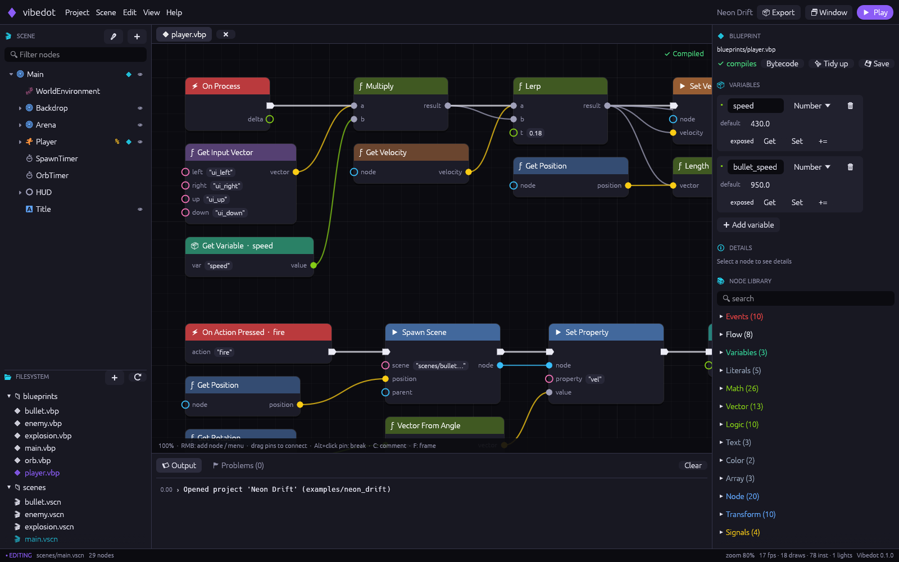
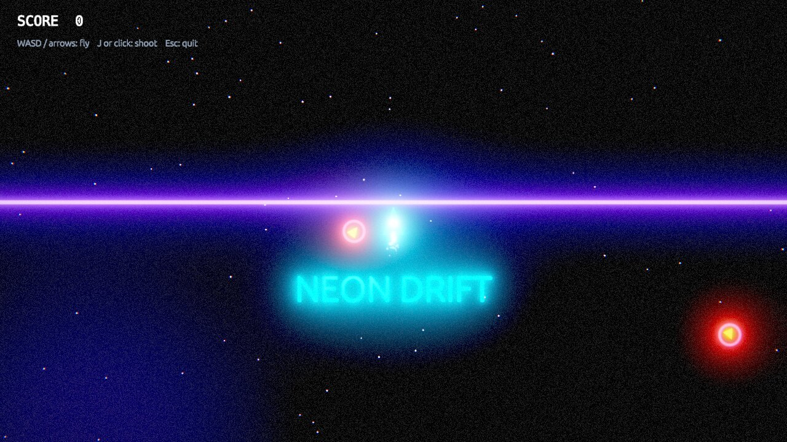

# Vibedot

**Vibedot** is a 2D game engine written in Rust. It follows the architecture and the
public API of [Godot](../godot/): `SceneTree`, `Node`, node paths, groups, signals,
notifications, `process_mode` and pause. It adds:

* **Blueprints**: Unreal-style visual scripting, compiled to register bytecode.
* **An HDR 2D renderer** on wgpu, with bloom, 2D lights, tonemapping and post effects.
* **A redesigned editor**.
* **One-command packaging** of a game into a standalone app for Linux, Windows or macOS.




## Quick start

You need [Rust](https://rustup.rs) 1.88 or newer. On Linux you also need
`libxkbcommon-dev libwayland-dev` and a Vulkan or GL driver.

```bash
./build.sh                                # build and open the editor (project manager)
./build.sh run                            # play the Neon Drift demo
./build.sh export vibedot/examples/neon_drift   # -> dist/linux/Neon Drift/ + .tar.gz
./build.sh sdk                            # package the editor itself as an app
./build.sh test                           # fmt + clippy -D warnings + all tests
```

On Windows, use `.\build.ps1` with the same commands. All build scripts live in the
repository root.

The editor binary is also a command-line tool:

```text
vibedot                                  open the project manager
vibedot <project-dir>                    open a project
vibedot new <dir> [--name N] [--template neon|empty]
vibedot run <project-dir>                run the game in the player
vibedot pack <project-dir> <out.vpk>     pack project files
vibedot export <project-dir> [--out dist] [--platform linux|windows|macos] [--player path]
vibedot check <project-dir>              compile every blueprint and load every scene
```

### What an export produces

| Platform | Layout |
|----------|--------|
| Linux    | `Game/game` (player) + `game.vpk` + `game.desktop` + `icon.png`, plus a `.tar.gz` |
| Windows  | `Game/Game.exe` + `game.vpk`, plus a `.zip` |
| macOS    | `Game.app/Contents/{MacOS/game, Resources/game.vpk, Info.plist}`, plus a `.zip` |

The player finds `game.vpk` next to its executable, or in `../Resources` inside a
macOS bundle. `.vpk` is a simple indexed archive with CRC-32 checks. Player keys:
**F11** toggles fullscreen and **F3** toggles the stats overlay.

To cross-export, install the Rust target and pass it to the script, for example
`./build.sh export my_game --target x86_64-pc-windows-gnu`.

## The editor

* **Project manager**: recent projects, create a project from a template (*Neon Drift*
  or *Empty*), or open one by path.
* **Scene dock**: the node tree. Drag nodes to reparent them, double-click to
  rename. Badges show scripts, groups and unique names. The *Add node* dialog
  has search.
* **Viewport**: shows the final HDR render (bloom and lights included) while you
  edit. It has move, rotate and axis gizmos with snapping, zoom to the cursor, a
  camera frame, and a HUD preview. Drop images from the file panel to create
  sprites, or drop scenes to instance them.
* **Inspector**: every reflected property, HDR color pickers, the script slot,
  groups, signal connections, and the blueprint's exposed variables.
* **Blueprint editor**: zoomable graph with category-colored nodes, typed pins and
  bezier wires.
  * Drag from a pin into empty space to open a palette filtered to compatible nodes.
  * Comments, box select, and copy/paste/duplicate.
  * **Tidy up** (automatic layout).
  * A live compile status and a bytecode viewer.
* **Play in editor** (F5) runs the game inside the viewport, with logs in the
  console. **F6** runs it in a separate window.
* Undo and redo cover scenes and blueprints (Ctrl+Z / Ctrl+Y). **Ctrl+S** saves
  everything. **Export** packages the game without leaving the editor.

## Architecture

```
crates/
  vd_core       arena (generational handles), StringName, Variant, math, PCG32;
                gd::* - faithful ports of Godot's Vector2, Rect2, Transform2D,
                Color (146 named colors), Math::*, String helpers
  vd_scene      Node, NodeKind (reflected properties), SceneTree, signals,
                notifications, groups, packed scenes (.vscn, JSON)
  vd_blueprint  node library (141 nodes), graph model + auto-layout, compiler,
                register VM
  vd_physics    2D bodies/areas: sweep-and-prune broadphase, MTV resolution,
                character slide, rigid bounce, layers/masks, enter/exit events
  vd_render     wgpu renderer: SDF ubershader, SDF text atlas, instanced
                batching, HDR MRT (albedo+emissive), 2D lights, bloom pyramid,
                ACES/AgX/Reinhard, vignette, chromatic aberration, grain, CRT
  vd_engine     Game loop, input map, assets (dir/pack), Rust scripts,
                blueprint host, timers, particles, camera, project templates
  vd_egui       egui integration: game viewport texture, input, theme
  vd_editor     `vibedot` - editor + CLI + exporter
  vd_player     `vibedot-player` - runtime for exported games
```

### Mapping to Godot

| Godot | Vibedot |
|-------|---------|
| `Object` / `ObjectID` | `Handle<Node>`: an index plus a non-zero generation into an arena. `Option<Handle>` is 8 bytes, and stale handles are detected rather than dangling. |
| `StringName` | `vd_core::StringName`: interned, with pointer comparison |
| `Variant` | `vd_core::Variant`: Nil, Bool, Number, Vec2, Color, String, Object, Array |
| `Vector2`, `Rect2`, `Transform2D`, `Color` | `vd_core::gd::*`, ported method by method. The tests are ported from `godot/tests/core/math`. |
| `Node::add_child`, `remove_child`, `queue_free`, `move_child`, `reparent`, `replace_by`, `duplicate` | `SceneTree` methods with the same semantics: orphan nodes, `@Class@N` auto names, `validate_node_name` |
| `get_node("../A/%Unique")`, `find_child("Pl*")`, `get_path_to` | the same, with Godot's wildcard matching |
| `NOTIFICATION_ENTER_TREE` / `READY` / `EXIT_TREE` | Same order: enter is pre-order, ready is post-order and fires once, exit is reverse |
| `process_mode`, `get_tree().paused`, `process_priority` | `ProcessMode::{Inherit, Pausable, WhenPaused, Always, Disabled}` and priorities |
| `connect(signal, callable, flags)` | `SceneTree::connect_with`, supporting `ONE_SHOT`, `PERSIST` (saved in `.vscn`), `REFERENCE_COUNTED` and binds |
| `PackedScene` / `.tscn` | `SceneFile` / `.vscn` (JSON) |
| GDScript `_ready` / `_process` / `_physics_process` | Blueprint events, or the Rust `NodeScript` trait (`rust:Name`) |
| `RenderingServer` (canvas) | `vd_render::Renderer`, which consumes an immutable `DrawList` |

### Blueprints

A blueprint is a JSON graph (`.vbp`) attached to a node. The compiler checks pin
types and turns it into compact bytecode. Each instruction is 12 bytes and uses
`u16` registers, and pure nodes are re-evaluated once per statement. The VM runs
the bytecode with an instruction budget, so an infinite loop cannot freeze the
game.

Latent nodes such as **Delay** suspend execution and resume later. Events cover
ready, process, physics, input actions, keys, collisions, timers, signals and
custom methods. The library has 141 nodes in these groups: flow, math, vectors,
logic, strings, color, arrays, nodes, transforms, physics, signals, timers,
particles, camera shake, scene spawning and pause.

### Rendering pipeline

1. **Scene pass.** Instanced SDF quads (rect, rounded rect, circle, ring,
   triangle, line, sprite, text) are drawn into two HDR targets, albedo and
   emissive.
2. **Light pass.** Additive 2D point lights are added on top of the ambient light.
3. **Bloom.** A 13-tap downsample pyramid, then a tent-filter upsample.
4. **Composite.** Exposure, then ACES, AgX or Reinhard tonemapping, then vignette,
   chromatic aberration, grain, scanlines, CRT curvature and pixelation.
5. **HUD.** Screen-space items are drawn after tonemapping.

All of these settings come from the scene's `WorldEnvironment` node.

## Code standards

* Every crate has `#![forbid(unsafe_code)]`. The workspace sets lints, and CI runs
  clippy with `-D warnings`.
* There is no global mutable state. The scene tree owns its nodes in an arena, and
  references between nodes are generational handles.
* Hot paths avoid allocation. Draw lists, VM registers and physics pairs are
  reused between frames.
* Rendering is tested headlessly on lavapipe (Mesa llvmpipe Vulkan). The test
  suite covers math (ported from Godot), the node API (ported from Godot), the
  compiler and VM, physics, the renderer, the runtime and export.

## Scope: what is *not* here

Vibedot follows Godot's design, but it does not replace all of Godot's 1.5M lines of
code. Not implemented:

* 3D
* GDScript and C#
* audio
* networking
* tilemaps
* animation player
* themes and Control-node UI layout
* shaders written by users
* the full Godot class library
* mobile and web export

The Godot sources in [`../godot`](../godot) are unchanged and serve as the reference.
